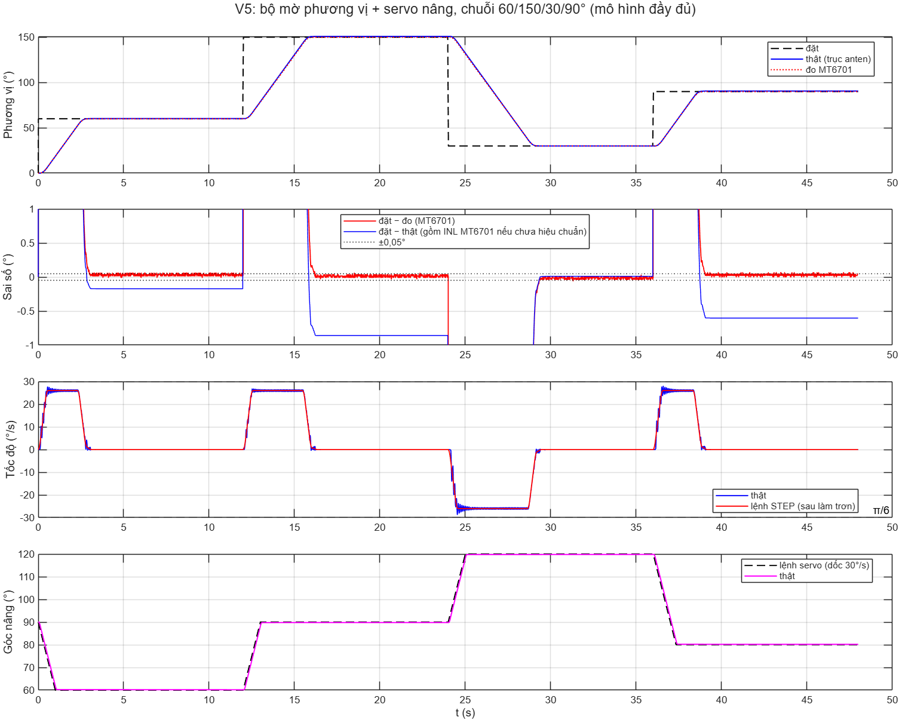

# Two-Axis Antenna Positioning with Fuzzy Control

MATLAB/Simulink simulation, STM32 firmware, and printable mechanical designs for a two-axis antenna positioning project.

[English](#english) · [Tiếng Việt](#tiếng-việt)


## English

### Overview and status

This coursework project combines a Sugeno fuzzy controller, an antenna plant simulation, embedded firmware, and a 3D-printable azimuth/elevation mechanism. **V5 is the current implementation**: a stepper motor drives azimuth through a 4:1 belt transmission, an MT6701 measures the antenna shaft angle, and a servo drives elevation using its internal position loop.

The assignment's original **DC-motor model** and earlier prototypes remain in `Simulation/` for comparison. Their results describe those models; use `Simulation_V5/` and `Firmware/antenna_zephyr/` for the current hardware configuration.

**Status:** simulations, host tests, and firmware build reports are available. Physical commissioning, on-board PIL, and printed assembly validation are still pending. Simulated performance is not a hardware measurement.

### Hardware configuration

| Component | Current V5 configuration |
| --- | --- |
| Microcontroller | STM32F103C8 Blue Pill; Zephyr 3.7.0 |
| Azimuth drive | 17HS1352-P4130 stepper + TB6600 at 12 V, 1/16 microstepping |
| Transmission | GT2 20T:80T pulleys, 4:1 reduction |
| Azimuth feedback | MT6701, 14-bit absolute angle, I2C2, mounted at the antenna shaft |
| Elevation drive | LD-1501MG servo at approximately 7 V; internal position feedback |
| Mechanical design | V5 reinforced servo carrier and open MT6701 sensor mount |
| Print setup | Bambu A1, 0.4 mm nozzle, PETG; calibration plate first |

Wiring, power connections, driver settings, and commissioning steps are in the [V5 firmware guide](Firmware/antenna_zephyr/README.md).

### Repository guide

| Path | Purpose |
| --- | --- |
| [`Simulation_V5/`](Simulation_V5/README.md) | Current plant model, shared C controller through MEX, Simulink, SIL/PIL, calibration, plots |
| [`Firmware/antenna_zephyr/`](Firmware/antenna_zephyr/README.md) | Current Zephyr firmware, portable C core, host tests, build/flash scripts |
| [`3D Print/Antenna_V5_Reinforced/`](3D%20Print/Antenna_V5_Reinforced/README_START_HERE.md) | Current CAD scripts, STEP/STL, 3MF projects, BOM, previews, mechanical audits |
| [`3D Print/`](3D%20Print/README.md) | Mechanical version index and printing entry points |
| [`Simulation/`](Simulation/README.md) | Original DC-motor assignment and earlier prototype simulations |
| [`Firmware/`](Firmware/README.md) | Earlier bare-metal V3 firmware and UART tools |
| [`Review_2026-10-24/`](Review_2026-10-24/README.md) | Historical review, hardware decisions, and test matrix |
| [Assignment PDF](Bài%20tập%20Điều%20khiển%20góc%20phương%20vị%20của%20antenna.pdf) | Original coursework requirements |

Keep these directories beside one another. Simulation scripts resolve the C core and CAD data using relative paths.

### Requirements

Install the tools needed for your task:

| Task | Tools |
| --- | --- |
| V5 simulation | MATLAB R2026a (used for stored reports), Simulink, Fuzzy Logic Toolbox, configured MEX C compiler |
| C host tests | Python 3 and GCC; set the `GCC` environment variable if needed |
| Firmware build | Windows PowerShell, Zephyr 3.7.0 workspace, Zephyr SDK 0.16.8, CMake, Ninja, dtc |
| Flashing | STM32CubeProgrammer with an ST-LINK or supported USB-UART connection |
| CAD regeneration | Python with CadQuery, NumPy, trimesh, Matplotlib; additional tools depend on the preview/slicing script |
| Printing | A slicer that opens 3MF; supplied A1/PETG projects target Bambu Studio |

Build and CAD scripts contain defaults for the original workstation. Set the documented firmware environment variables and install CAD dependencies in your own Python environment before regenerating assets.

### Quick start

**1. Test the controller on your computer**

From the repository root:

```powershell
python "Firmware/antenna_zephyr/tests/host/run_host_tests.py"
```

This compiles the portable controller and a virtual board, runs host tests, and generates test vectors in `Firmware/antenna_zephyr/tests/host/out/`. Run it before SIL/PIL so MATLAB can compare against the host vectors and use the virtual board.

**2. Run the V5 simulation**

In MATLAB, open the repository root and run:

```matlab
cd('Simulation_V5')
mex -setup C                    % First-time compiler setup
v5_build_mex                    % Build from the firmware C sources
v5_sil_check(true)               % SIL and PIL through the virtual board

r = v5_simulate(v5_config(), v5_scenario('pdf'));
v5_plot(r)
```

Further commands, from the same MATLAB folder:

```matlab
v5_run_all                      % Full scenario suite, figures, and CAD video
v5_build_simulink               % Build and validate the Simulink model
v5_view_cad(30, 60)              % Interactive CAD view: azimuth/elevation
v5_calibration_demo              % Simulated MT6701 calibration
```

The full workflow recreates local `results/` data. See the [simulation guide](Simulation_V5/README.md) for model assumptions, tuning, scenarios, and real-board commands.

**3. Build the current firmware**

From the repository root in PowerShell:

```powershell
powershell -ExecutionPolicy Bypass -File "Firmware/antenna_zephyr/build.ps1"
```

If your tools are installed elsewhere, configure `ZEPHYR_BASE`, `ZEPHYR_SDK_INSTALL_DIR`, `ZEPHYR_VENV`, and `DTC_DIR`. The script temporarily maps the app directory to `W:` to handle non-ASCII paths; set `ANTENNA_DRIVE` to another free drive letter if necessary.

The build produces `Firmware/antenna_zephyr/dist/antenna_v5_bluepill.hex` and related artifacts. Follow the [wiring and first-run procedure](Firmware/antenna_zephyr/README.md#5-chạy-thử-lần-đầu) before flashing or powering the mechanism.

**4. Explore and print the mechanics**

Start with the [V5 mechanical guide](3D%20Print/Antenna_V5_Reinforced/README_START_HERE.md), then read the [A1/PETG print setup](3D%20Print/Antenna_V5_Reinforced/print_profiles/README_A1_PETG.md). Use `3MF_A1_PETG_0p4/` for configured print projects and begin with plate 00 to check fits. `STL/` contains printable parts; `STEP/` contains CAD exports. Older V2–V4 designs are retained as references.

### Validation evidence and limits

The checked-in [V5 report](Simulation_V5/results/v5_validation.json) and [scenario table](Simulation_V5/results/v5_scenarios.csv) record:

| Check | Stored result |
| --- | --- |
| Fuzzy surface, C MEX vs MATLAB | 40,401 points; zero difference |
| C MEX vs Fuzzy Logic Toolbox | Maximum difference approximately 1.4 × 10⁻⁷ |
| STEP generator, C vs MATLAB | 3,000 cases; zero mismatches |
| PIL through the virtual board | 2,000 steps; zero bit mismatches |
| Scenario suite | 23 scenarios passing their respective acceptance checks |



These checks verify software consistency under modeled conditions. Some plant parameters still need identification on real hardware. Absolute azimuth accuracy depends on MT6701 calibration. The combined adverse scenario reaches about **30.2°/s**, slightly above the nominal 30°/s target; passing scenario checks does not imply that every scenario satisfies every nominal performance target. Elevation has no external angle sensor, and mechanical strength has not been verified by physical load testing.

### Repository maintenance

- Source code, CAD/print assets, documentation, and compact validation reports/figures are versioned.
- `.gitignore` excludes Simulink/Python/CAD caches, firmware and host build folders, MEX binaries, generated result MAT files, local telemetry/calibration files, and duplicate top-level CAD ZIP packages. Regenerate these locally when needed.
- Source-level MAT/FIS files, Simulink models, STEP/STL, and 3MF projects remain included. `.gitattributes` keeps text line endings consistent and marks binary assets appropriately.
- Preserve the relative folder layout when adding versions, and update the relevant guide when changing hardware or control parameters.

---

## Tiếng Việt

### Giới thiệu và trạng thái

Bài tập lớn này kết hợp bộ điều khiển mờ Sugeno, mô hình mô phỏng anten, firmware nhúng và cơ cấu phương vị/góc nâng có thể in 3D. **V5 là phiên bản hiện hành**: động cơ bước điều khiển phương vị qua bộ truyền đai 4:1, MT6701 đo trực tiếp góc trục anten, còn servo điều khiển góc nâng bằng vòng vị trí bên trong.

**Mô hình động cơ DC** của đề bài gốc và các nguyên mẫu trước vẫn được giữ trong `Simulation/` để đối chiếu. Kết quả của chúng chỉ áp dụng cho các mô hình đó; với cấu hình phần cứng hiện tại, hãy dùng `Simulation_V5/` và `Firmware/antenna_zephyr/`.

**Trạng thái:** đã có mô phỏng, kiểm thử trên máy tính và báo cáo build firmware. Chưa chạy thử hệ thống thật, chưa PIL trên chip và chưa xác nhận lắp ghép bằng chi tiết in thực tế. Kết quả mô phỏng không phải số đo phần cứng.

### Cấu hình phần cứng

| Thành phần | Cấu hình V5 hiện hành |
| --- | --- |
| Vi điều khiển | STM32F103C8 Blue Pill; Zephyr 3.7.0 |
| Truyền động phương vị | Động cơ bước 17HS1352-P4130 + TB6600 cấp 12 V, vi bước 1/16 |
| Bộ truyền | Pulley GT2 20T:80T, giảm tốc 4:1 |
| Phản hồi phương vị | MT6701, góc tuyệt đối 14 bit, I2C2, đặt tại trục anten |
| Truyền động góc nâng | Servo LD-1501MG cấp khoảng 7 V; phản hồi vị trí bên trong |
| Cơ khí | V5 với giá servo gia cố và gá MT6701 dạng mở |
| Cấu hình in | Bambu A1, đầu phun 0,4 mm, PETG; in bàn hiệu chuẩn trước |

Sơ đồ dây, cách cấp nguồn, thiết lập driver và quy trình chạy thử nằm trong [hướng dẫn firmware V5](Firmware/antenna_zephyr/README.md).

### Cấu trúc thư mục

| Đường dẫn | Nội dung |
| --- | --- |
| [`Simulation_V5/`](Simulation_V5/README.md) | Mô hình hiện hành, lõi C dùng chung qua MEX, Simulink, SIL/PIL, hiệu chuẩn và đồ thị |
| [`Firmware/antenna_zephyr/`](Firmware/antenna_zephyr/README.md) | Firmware Zephyr hiện hành, lõi C độc lập, kiểm thử máy tính, script build/nạp |
| [`3D Print/Antenna_V5_Reinforced/`](3D%20Print/Antenna_V5_Reinforced/README_START_HERE.md) | Script CAD, STEP/STL, dự án 3MF, BOM, ảnh lắp ráp và báo cáo cơ khí V5 |
| [`3D Print/`](3D%20Print/README.md) | Mục lục các phiên bản cơ khí và hướng dẫn bắt đầu in |
| [`Simulation/`](Simulation/README.md) | Mô hình động cơ DC theo đề và mô phỏng nguyên mẫu cũ |
| [`Firmware/`](Firmware/README.md) | Firmware bare-metal V3 và công cụ UART cũ |
| [`Review_2026-10-24/`](Review_2026-10-24/README.md) | Rà soát lịch sử, quyết định phần cứng và ma trận kiểm thử |
| [PDF đề bài](Bài%20tập%20Điều%20khiển%20góc%20phương%20vị%20của%20antenna.pdf) | Yêu cầu gốc của bài tập lớn |

Giữ các thư mục này cùng cấp. Script mô phỏng dùng đường dẫn tương đối để tìm lõi C và dữ liệu CAD.

### Công cụ cần thiết

Cài các công cụ tương ứng với phần bạn cần sử dụng:

| Công việc | Công cụ |
| --- | --- |
| Mô phỏng V5 | MATLAB R2026a (bản dùng cho báo cáo đã lưu), Simulink, Fuzzy Logic Toolbox và trình biên dịch C đã cấu hình cho MEX |
| Kiểm thử lõi C | Python 3 và GCC; đặt biến môi trường `GCC` nếu cần |
| Build firmware | Windows PowerShell, workspace Zephyr 3.7.0, Zephyr SDK 0.16.8, CMake, Ninja và dtc |
| Nạp firmware | STM32CubeProgrammer cùng ST-LINK hoặc kết nối USB-UART phù hợp |
| Tái tạo CAD | Python có CadQuery, NumPy, trimesh và Matplotlib; công cụ bổ sung tùy script dựng ảnh/cắt lớp |
| In 3D | Phần mềm cắt lớp mở được 3MF; các dự án A1/PETG đi kèm dành cho Bambu Studio |

Script build và CAD có giá trị mặc định theo máy phát triển ban đầu. Hãy đặt các biến môi trường firmware được hướng dẫn và cài thư viện CAD vào môi trường Python của bạn trước khi tái tạo dữ liệu.

### Chạy nhanh

**1. Kiểm thử bộ điều khiển trên máy tính**

Từ thư mục gốc của repo:

```powershell
python "Firmware/antenna_zephyr/tests/host/run_host_tests.py"
```

Lệnh này biên dịch lõi điều khiển và board ảo, chạy kiểm thử rồi tạo vector đối chiếu trong `Firmware/antenna_zephyr/tests/host/out/`. Chạy bước này trước SIL/PIL để MATLAB có vector từ bản C và dùng được board ảo.

**2. Chạy mô phỏng V5**

Trong MATLAB, mở thư mục gốc của repo rồi chạy:

```matlab
cd('Simulation_V5')
mex -setup C                    % Chọn trình biên dịch lần đầu
v5_build_mex                    % Biên dịch từ mã C của firmware
v5_sil_check(true)               % SIL và PIL qua board ảo

r = v5_simulate(v5_config(), v5_scenario('pdf'));
v5_plot(r)
```

Các lệnh bổ sung, chạy trong cùng thư mục MATLAB:

```matlab
v5_run_all                      % Toàn bộ kịch bản, hình và video CAD
v5_build_simulink               % Dựng và kiểm tra mô hình Simulink
v5_view_cad(30, 60)              % Xem CAD tương tác: phương vị/góc nâng
v5_calibration_demo              % Minh họa hiệu chuẩn MT6701 bằng mô phỏng
```

Quy trình đầy đủ tạo lại dữ liệu `results/` trên máy. Xem [hướng dẫn mô phỏng](Simulation_V5/README.md) để biết giả định mô hình, cách chỉnh tham số, các kịch bản và lệnh cho board thật.

**3. Build firmware hiện hành**

Từ thư mục gốc của repo trong PowerShell:

```powershell
powershell -ExecutionPolicy Bypass -File "Firmware/antenna_zephyr/build.ps1"
```

Nếu cài công cụ ở vị trí khác, đặt `ZEPHYR_BASE`, `ZEPHYR_SDK_INSTALL_DIR`, `ZEPHYR_VENV` và `DTC_DIR`. Script tạm ánh xạ thư mục ứng dụng sang ổ `W:` để xử lý đường dẫn có dấu; đặt `ANTENNA_DRIVE` thành một ký tự ổ còn trống nếu cần.

Kết quả build gồm `Firmware/antenna_zephyr/dist/antenna_v5_bluepill.hex` và các file liên quan. Làm theo [quy trình đấu dây và chạy thử lần đầu](Firmware/antenna_zephyr/README.md#5-chạy-thử-lần-đầu) trước khi nạp hoặc cấp nguồn cho cơ cấu.

**4. Xem thiết kế và in cơ khí**

Bắt đầu bằng [hướng dẫn cơ khí V5](3D%20Print/Antenna_V5_Reinforced/README_START_HERE.md), sau đó đọc [thiết lập in A1/PETG](3D%20Print/Antenna_V5_Reinforced/print_profiles/README_A1_PETG.md). Dùng các dự án đã cấu hình trong `3MF_A1_PETG_0p4/` và in bàn 00 trước để kiểm tra dung sai lắp. `STL/` chứa chi tiết in; `STEP/` chứa bản xuất CAD. Các thiết kế V2–V4 được giữ để tham khảo.

### Bằng chứng kiểm thử và giới hạn

[Báo cáo V5](Simulation_V5/results/v5_validation.json) và [bảng kịch bản](Simulation_V5/results/v5_scenarios.csv) được lưu trong repo ghi nhận:

| Kiểm tra | Kết quả đã lưu |
| --- | --- |
| Mặt mờ, C MEX so với MATLAB | 40.401 điểm; sai khác bằng 0 |
| C MEX so với Fuzzy Logic Toolbox | Sai khác lớn nhất khoảng 1,4 × 10⁻⁷ |
| Bộ phát STEP, C so với MATLAB | 3.000 ca kiểm thử; không có sai khác |
| PIL qua board ảo | 2.000 bước; không có sai khác bit |
| Bộ kịch bản | 23 kịch bản đạt điều kiện kiểm tra tương ứng |


Các kiểm tra này xác nhận tính nhất quán phần mềm trong điều kiện mô hình. Một số tham số đối tượng vẫn cần nhận dạng trên phần cứng thật. Độ chính xác phương vị tuyệt đối phụ thuộc hiệu chuẩn MT6701. Kịch bản bất lợi kết hợp đạt khoảng **30,2°/s**, hơi vượt mục tiêu danh định 30°/s; việc đạt kiểm tra của kịch bản không có nghĩa mọi kịch bản đều thỏa mọi chỉ tiêu danh định. Trục nâng chưa có cảm biến góc ngoài, và độ bền cơ khí chưa được xác nhận bằng thử tải thực tế.

### Quy ước quản lý repo

- Theo dõi mã nguồn, dữ liệu CAD/in 3D, tài liệu, báo cáo và hình kiểm chứng gọn nhẹ.
- `.gitignore` loại cache Simulink/Python/CAD, thư mục build firmware và kiểm thử, MEX đã biên dịch, MAT kết quả sinh tự động, file telemetry/hiệu chuẩn cục bộ và gói ZIP CAD trùng ở cấp trên. Tạo lại các file này trên máy khi cần.
- Vẫn giữ MAT/FIS ở cấp mã nguồn, mô hình Simulink, STEP/STL và dự án 3MF. `.gitattributes` thống nhất kiểu xuống dòng văn bản và nhận diện tài sản nhị phân.
- Giữ cấu trúc thư mục tương đối khi thêm phiên bản, đồng thời cập nhật hướng dẫn liên quan khi thay đổi phần cứng hoặc tham số điều khiển.
